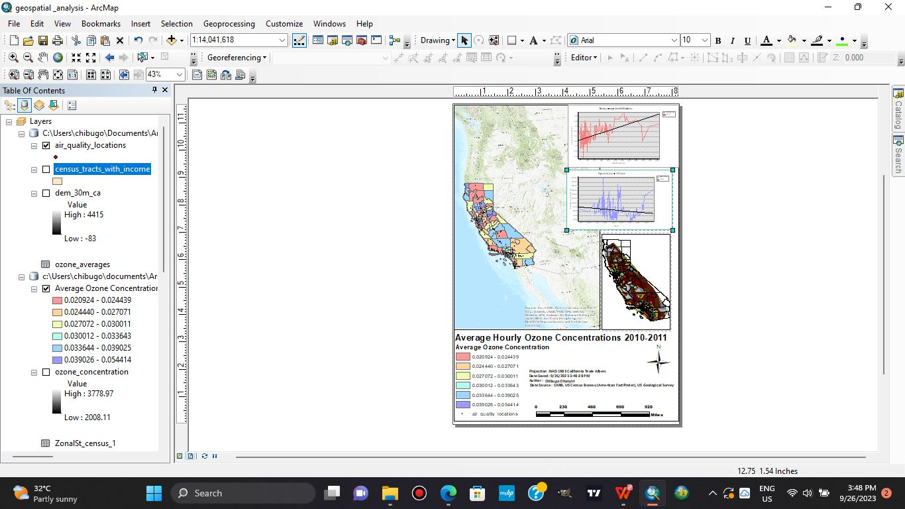

# Spatial analysis of ozone concentrations: California, USA

**Personal project · 2023** · ArcMap

## The question
How do ground-level ozone concentrations vary across California, and do they relate to **household income** and **elevation**?

## What I did
- **Interpolated** ozone measurements from monitoring stations into a continuous surface, estimating values between stations.
- Extracted **mean ozone concentration** by **census tract** and by **elevation zone**.
- Compared these with household income and elevation.
- Produced **thematic maps** and **trend-line graphs** to communicate the spatial patterns and the associations observed.

## Result
Maps of average hourly ozone concentration for **2010–2011**, with graphs showing how ozone relates to income and elevation.

*The final map layout in ArcMap: average hourly ozone concentration by county class, monitoring stations, a statewide terrain inset, and two trend-line graphs. Layers in the project include air-quality station locations, census tracts with income, a 30 m California DEM and zonal-statistics tables. Map projection NAD 1983 California Teale Albers. Data: California Air Resources Board (CARB), US Census (American FactFinder), US Geological Survey.*

## Skills shown
Spatial interpolation · zonal statistics · census-tract analysis · thematic mapping · charting

## Limits
Interpolated values are estimates between monitoring stations, and the associations found are correlations, not causes.
