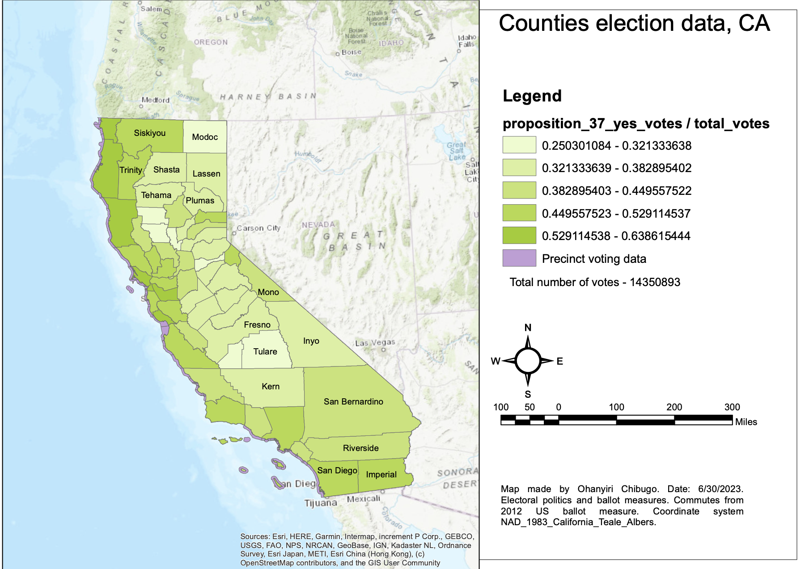

# Spatial analysis of Proposition 37 voting patterns: California, USA

**Personal project · 2023** · ArcGIS

## The question
In 2012, California's Proposition 37 asked whether genetically engineered food should be labelled. Where in California was support for it strongest?

## What I did
- Analysed **2012 precinct-level election results** and county boundaries, supplied through UC Davis.
- **Aggregated** precinct results to calculate the **county-level share of "Yes" votes**.
- Produced a **thematic (choropleth) map** using **Jenks Natural Breaks** classification. This method groups counties so that similar values fall in the same class.

## Result
A county-level map comparing geographic patterns of support for Proposition 37.

*Share of "Yes" votes on Proposition 37 by county, in five Jenks classes from 0.25 to 0.64, built from 14,350,893 precinct votes (NAD 1983 California Teale Albers). Support was highest in north-coast and San Francisco Bay Area counties and lowest in counties such as Modoc and Tulare.*

## Skills shown
Data aggregation (precinct to county) · attribute joins · choropleth mapping · classification methods (Jenks)
