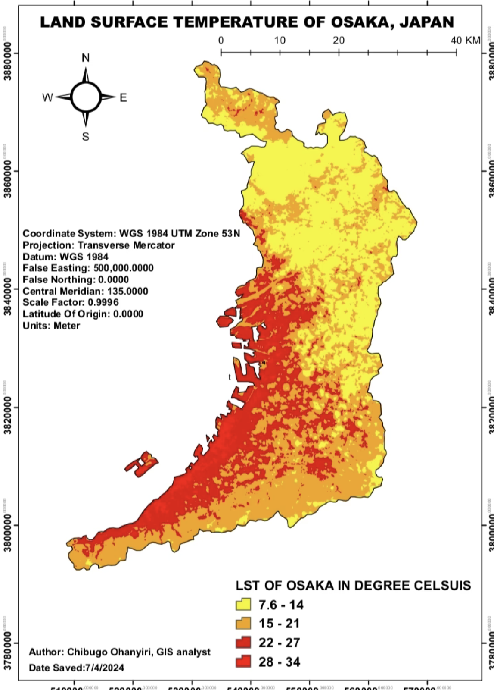

# Land surface temperature analysis: Osaka, Japan

**Personal project · 2024** · Landsat 8

## The question
Where is the ground surface hottest in Osaka, and how does that relate to **urban development** and **population**?

## What I did
- Processed **Landsat 8** satellite imagery, including its thermal band.
- Derived **land surface temperature (LST)** using the **Single-Channel Algorithm**, which converts thermal-band readings into surface temperature.
- Mapped areas of **elevated surface temperature** and examined how they relate to urban development and population distribution.

## Result
A land surface temperature map of Osaka with analysis of hot spots against urban development and population.

*Land surface temperature of Osaka Prefecture in four classes from 7.6 to 34 °C (WGS 1984 UTM Zone 53N). The hottest classes (22–34 °C) form a band along the western bay and port area and the dense urban core; the cooler classes (7.6–21 °C) lie mostly in the north and east.*

## Skills shown
Landsat 8 processing · thermal remote sensing · LST retrieval (Single-Channel Algorithm) · urban heat analysis

## Limits
LST is the temperature of the ground surface at the moment of the satellite pass, not air temperature.
