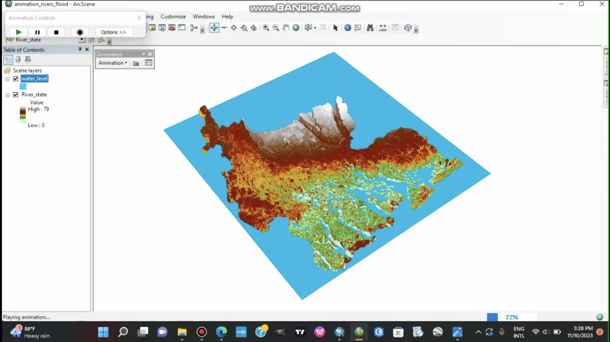

# 3D flood-inundation visualisation: Rivers State, Nigeria

**Individual project · November 2023 · ArcScene · 🏆 Second runner-up, GIS Day Nigeria StoryMap Competition (national)**

**[Open the StoryMap (ArcGIS)](https://arcg.is/zP089)**

## The question
Which parts of Rivers State sit low enough to be exposed if water levels rise, and how can that be shown so non-specialists understand it at a glance?

## What I did
- Built a **3D terrain visualisation** of Rivers State from elevation data and administrative boundaries.
- Simulated **hypothetical water-level increases** on the terrain to explore potential inundation.
- Identified **low-lying areas** and explained terrain-related flood exposure in a **StoryMap**: a web story that combines maps, 3D views and text.

*The 3D scene in ArcScene, recorded while the flood animation was playing. The Rivers State elevation surface (legend 0–79, coloured from green for low ground to brown and white for high ground) sits under a blue `water_level` plane that is raised step by step. The low-lying southern areas around the creeks and coast are the first to go under.*

## Result
The StoryMap was awarded **second runner-up** in the national GIS Day Nigeria StoryMap Competition.

## Skills shown
3D terrain modelling · elevation analysis · flood-exposure communication · StoryMap design · presenting to an audience

## Limits
The water levels were hypothetical scenarios, not a hydrological flood model. The visualisation shows terrain exposure, not predicted flood extent.

## Related
My later Sentinel-1 radar project on the 2026 Lagos flood moves from hypothetical terrain exposure to observed surface change: [stac-environmental-processor](https://github.com/ChibugoOhanyiri/stac-environmental-processor).
