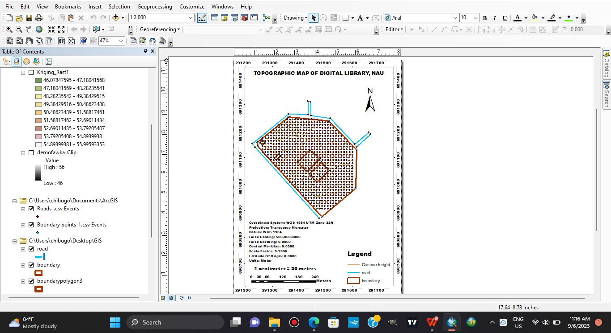

# Topographic mapping of the Digital Library, Nnamdi Azikiwe University

**Group project · 2023** · ArcMap

## The question
Produce an accurate topographic map of the Digital Library area at Nnamdi Azikiwe University (UNIZIK), Awka, from field survey data.

## What I did (within the group)
- Took part in **DGPS/GNSS field-data collection**: satellite-positioning survey with a correction for higher accuracy.
- Helped process the **survey coordinates into CSV** for spatial analysis in **ArcGIS**.
- Used **SRTM elevation data** and **Kriging interpolation** in ArcGIS to model the terrain. Kriging is a statistical method that estimates heights between measured points.
- Contributed to the final topographic map, which shows **contours, spot heights, buildings, roads and boundaries**.

## Result
A topographic map of the Digital Library area combining field-surveyed positions with modelled terrain.

*The map layout in ArcMap at 1:3,000: the library boundary, roads and a dense grid of surveyed points, with contour heights from the Kriging surface (about 46–56 m). Coordinate system WGS 1984 UTM Zone 32N. Layers include the Kriging raster, a clipped Awka elevation model, and road and boundary points imported from the survey CSVs.*

## Skills shown
GNSS/DGPS field survey · coordinate processing · ArcGIS · SRTM DEM · Kriging interpolation · topographic cartography · teamwork

## My role
A group project. I took part in field collection and the ArcGIS mapping workflow, and contributed to the terrain model and the map.
