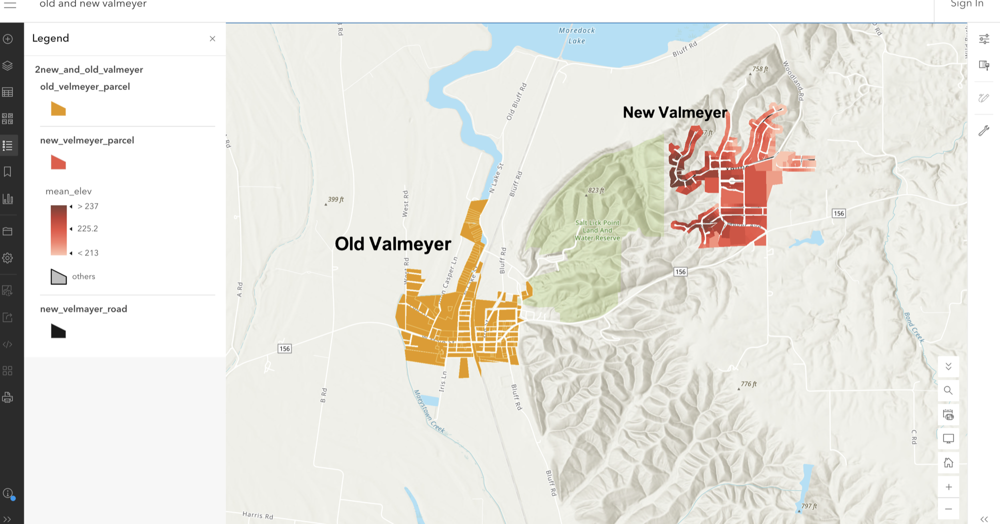

# Parcel and terrain analysis: Valmeyer, Illinois, USA

**Personal project · 2024**

## The question
Valmeyer is a town that moved to higher ground after flooding. How do its **original and relocated sites** compare in elevation and slope, and what does that mean for access in an emergency?

## What I did
- Mapped the town's **original** and **relocated** settlement areas.
- Calculated **parcel-level elevation and slope statistics** for both.
- Built an **interactive web map** combining parcels, roads and terrain attributes, to explore the relocation and possible emergency-access considerations.

## Result
An interactive web map and parcel statistics comparing the old and new town.

*The interactive web map. **Old Valmeyer** (orange parcels) sits on the low floodplain west of the bluffs, near spot heights of about 400 ft. **New Valmeyer** (red parcels) sits on the upland to the east, near spot heights of about 760–820 ft, with its parcels shaded by mean elevation (legend from below 213 to above 237). The Salt Lick Point Land and Water Reserve lies between the two sites, and the new town's roads are shown in black.*

## Skills shown
Parcel analysis · elevation and slope (DEM) statistics · interactive web mapping · flood-relocation context
